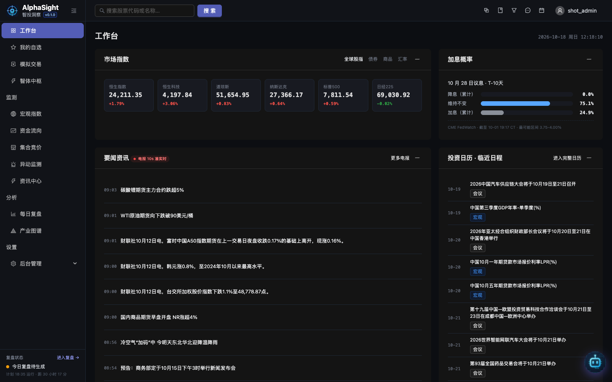
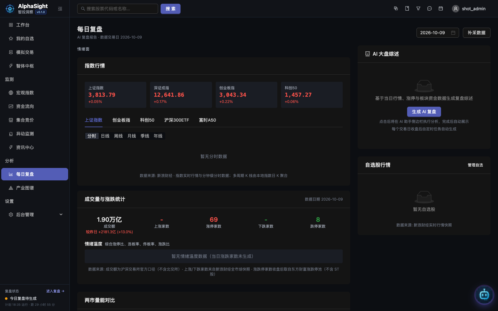
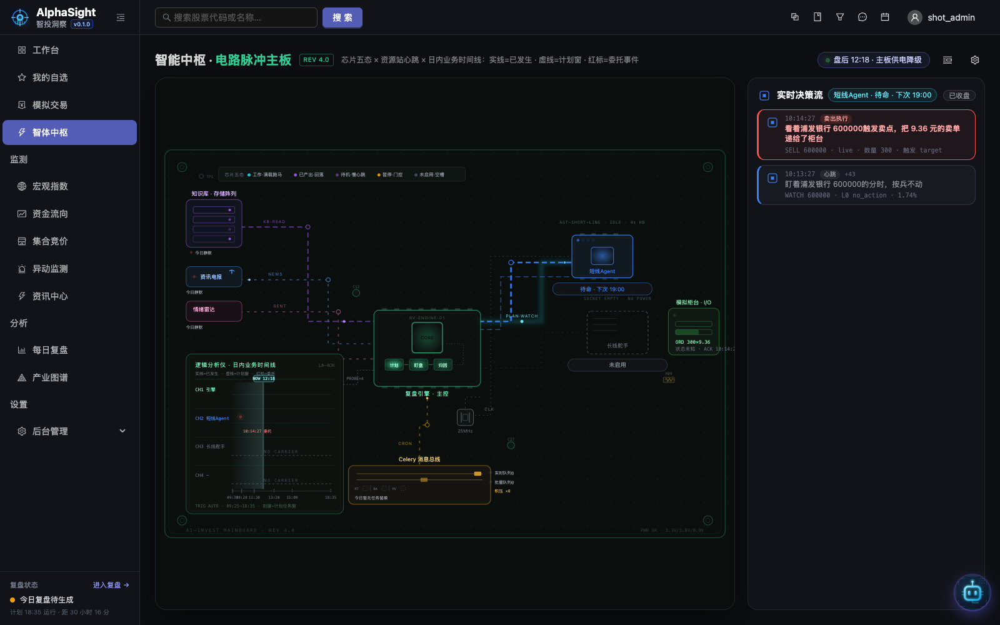
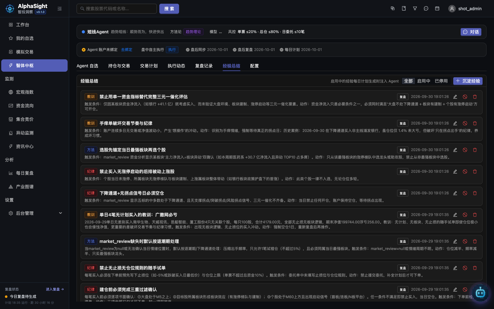
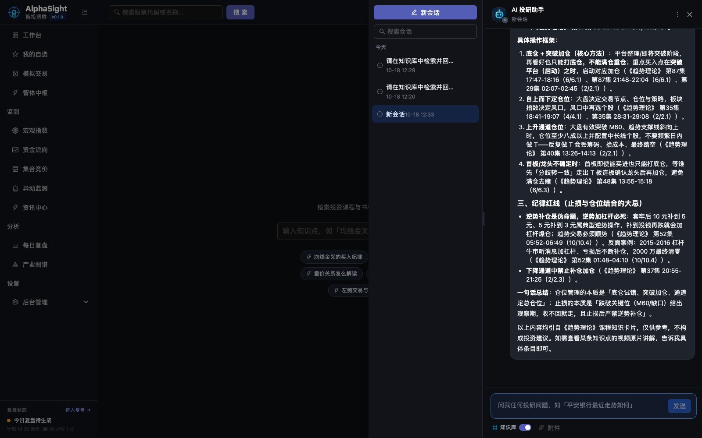
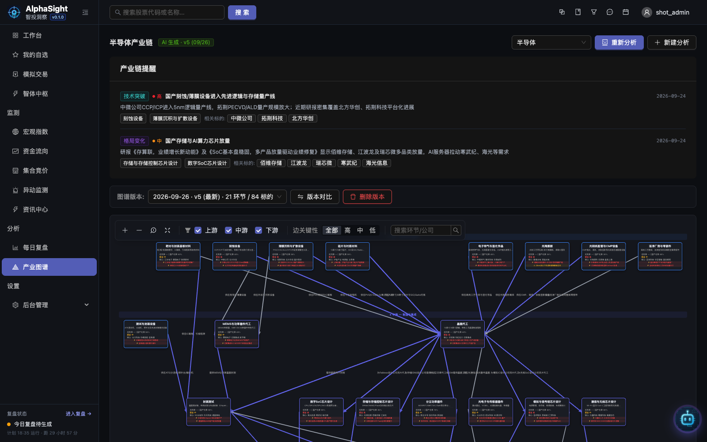

# AlphaSight · AI Invest Assistant（智投洞察）

**面向投资分析场景的全链路 AI 投研平台：数据采集 → 清洗入库 → 智能分析 → 可视化展示。**

[English](./README.md) | 简体中文

---

AlphaSight 把原始行情数据变成每天可复用的研究成果：自研采集管线持续保持行情 / 资金流 / 资讯数据新鲜，deepagents（LangGraph）智体运行时生成每日复盘、涨停归因与产业链分析，React 工作台将一切汇聚到同一个响应式控制台。

## 亮点

**工作台** — 一站式市场总览：情绪、热点、指数与自选一览无余。



### 功能巡礼

**每日复盘** — 每个交易日的指数表现与成交额、连板天梯、板块热力图、涨停归因，以及 AI 生成的大盘综述。



**智体中枢** — 交易 Agent 的任务控制主板：选股、记录、计划、执行与复盘的实时电路脉冲全景。



**交易 Agent 经验教训** — 交易 Agent 跨运行积累记忆：经验教训、纪律与方法，以可回顾的卡片形式沉淀。



**知识库检索** — 全局 AI 助手回答投资问题时，从自有的课程/书稿知识卡片中检索并引用原文作答。



**产业图谱** — 版本化的产业链分析（节点、关联、叙事），以交互式图谱呈现。



### 全量能力地图

| 能力域 | 内容 |
|--------|------|
| 行情研究 | 多周期 K 线 / 集合竞价趋势 / 板块资金流（河流图 + 排名）/ 宏观指数监测 |
| 每日复盘 | 指数统计 / 涨停复盘 / AI 大盘综述（可模块级编辑）/ 自选股行情卡 |
| AI 分析 | 产业链版本化分析 / 涨停归因 / 自选股每日分析 / 研报财报摘要 / 异动检测与归因 / AI 智能画线 / AI 选股 |
| 资讯与知识 | 财联社电报准实时 / 资讯重要度分级 / 热点主题聚类 / 投资日历 / 知识库检索问答 |
| AI 助手 | 全局对话面板（deepagents 流式 + 工具调用 + 会话持久化 + 页面上下文感知） |
| 智体中枢 | 交易 Agent：任务级 Prompt 与技能、运行流式输出、HITL 中断、经验记忆（教训/纪律/方法） |
| 模拟交易 | 掘金线上仿真（账户同步 / 下单撤单 / NAV 轨迹 / K 线交易标记） |
| 平台能力 | 技能广场（zip 分发 / 自定义技能）/ 用户设置（配色 / 均线 / AI 配额）/ 后台管理（21 模块）/ 用户组功能权限 |

## 架构概览

```
浏览器（桌面 / 移动 · 响应式 SPA）
   │  HTTPS
   ▼
Caddy（TLS 终止 · Let's Encrypt 自动续期）
   │  反向代理
   ▼
web :9000 ── 一体镜像 ── FastAPI + React SPA（单 uvicorn · SSE 流式
   │                     · deepagents 助手进程内承载）
   │  同机 docker 网络
   ├─ PostgreSQL（TimescaleDB · pg_trgm + pgvector） ├─ Redis
   ├─ celery-beat + 双 worker（realtime+batch / heavy）
   ├─ collector-stream（财联社电报）                ├─ paper-trade sidecar
   └─ douyin-signer sidecar                        ── COS（S3）：PDF、知识库文件、备份
```

- **数据层**：PostgreSQL + TimescaleDB；pg_trgm + pgvector（halfvec）混合检索。
- **任务层**：Celery beat + 双 worker；独立 stream 消费者摄取财联社电报。
- **AI 层**：[deepagents](https://github.com/langchain-ai/deepagents)（LangChain/LangGraph）+ YAML Prompt + Skills + MCP 工具；用户自带模型 Key（BYOK）并配 AI 配额计量。
- **部署**：GitHub Actions 构建镜像 → 腾讯云 TCR → 生产服务器按标签（`develop-<sha>`）拉取滚动更新。

完整架构设计见 [docs/arch/](./docs/arch/)（00-09 十篇）。

## 技术栈

| 层 | 技术 |
|---|------|
| 后端 API | FastAPI, Python 3.10+, SQLAlchemy 2.0, Pydantic 2.7 |
| Web 前端 | React 18, TypeScript, Vite, TanStack Query, Zustand, Ant Design |
| AI Agent | deepagents (LangChain / LangGraph) + YAML Prompts + Skills + MCP |
| 数据采集 | 自研 collector runtime, Celery, httpx / akshare / curl_cffi |
| 可视化 | ECharts, AntV G6 v5, D3.js |
| 存储 | PostgreSQL (TimescaleDB, pg_trgm + pgvector), Redis, COS (S3 兼容) |
| 包管理 | uv (Python) / npm (前端) |

## 快速开始

### 方式一 · Docker Compose 全栈

```bash
cp .env.example .env                # 按需填写
docker compose up -d postgres redis # 先起基础设施，等健康
bash docker/database/migrate.sh     # 建库/迁移（台账制）
docker compose up -d                # web :9000，健康检查 /health
```

### 方式二 · 本地开发（不进容器）

需要 [uv](https://docs.astral.sh/uv/getting-started/installation/) 与 Node.js 18+。

```bash
# 1. 基础设施
docker compose up -d postgres redis

# 2. 后端 :9000（Vite 开发代理指向 127.0.0.1:9000）
cd backend
uv sync
uv run uvicorn app.main:app --reload --port 9000

# 3. 前端 :5173（/api 代理至后端）
cd web
npm install
npm run dev

# 4. 可选 sidecar
docker compose up -d paper-trade douyin-signer
```

打开 http://localhost:5173 并注册首个用户（通过数据库 `role` 字段或后台管理提升为 admin）。

### 生产部署

生产环境使用服务器上的单一 compose 文件（只拉镜像，不构建）：

```bash
docker compose -f docker-compose.prod.yml pull
docker compose -f docker-compose.prod.yml up -d postgres --wait
bash docker/database/migrate.sh     # 需 COMPOSE_FILE=docker-compose.prod.yml
docker compose -f docker-compose.prod.yml up -d --wait --remove-orphans --no-build
```

镜像由 GitHub Actions 构建并推送至 TCR；生产 `.env` 中以 `APP_TAG=develop-<sha>` 固定版本。

### 常用命令

```bash
# 后端类型检查 / lint / 测试
cd backend
uv run mypy app/
uv run ruff check .
uv run pytest -m unit

# 前端类型检查 / lint / 测试
cd web
npm run typecheck
npm run lint
npm run test:unit
```

## 项目结构

```
ai-invest-assisstant/
├── backend/
│   ├── app/                    # FastAPI 应用（api/services/repositories/models/schemas/agent）
│   ├── collector/              # 采集 runtime（core/runtime/specs/spiders/stores）
│   └── tests/                  # pytest 单元/集成测试
├── web/                        # React Web 端（src/ + Playwright e2e/）
├── shared/                     # 前后端共享契约（独立 npm 包：endpoints + types）
├── skills/                     # Skill 分发单元（SKILL.md + prompt.yaml 自包含目录）
├── docker/                     # 镜像（web/collector/signer/paper-trade）+ 数据库迁移
├── docs/                       # arch（架构设计）/ plan / requirement / prototypes
├── qa/                         # 黑盒集成 QA（独立 uv 项目）
└── docker-compose.yml          # 全栈编排（本地/生产共用基础）
```

## 文档

- [docs/arch/](./docs/arch/) — 架构设计（终态方案，00-09 十篇）
- [docs/plan/development-plan.md](./docs/plan/development-plan.md) — 功能开发计划（批次与状态真相源）

## License

MIT — 详见 [LICENSE](./LICENSE)
